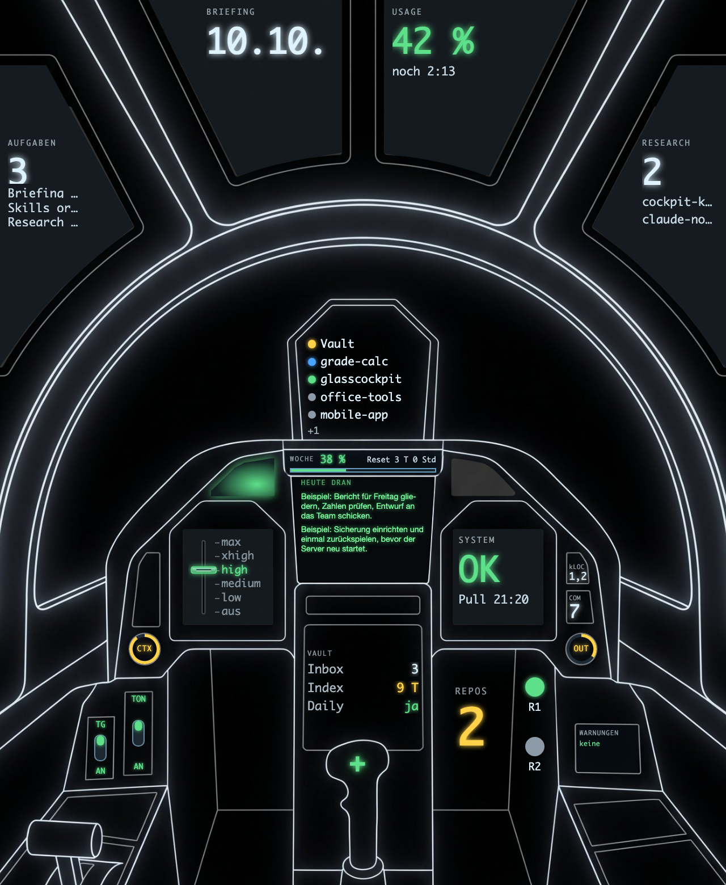

# Glasscockpit

[English](README.md) | Deutsch



Glasscockpit ist ein Obsidian-Plugin. Es startet [Claude-Code](https://code.claude.com)-Sitzungen als Terminal-Tabs im Vault. Ein Dashboard zeigt Limits, Kontextgröße, Aufgaben, Vault-Lage und GitHub-Suchergebnisse, wahlweise als Karten oder als Cockpit-Bild. Das Foto oben zeigt Beispieldaten.

Vorbild war das Plugin Agentic OS von skaile.de; Glasscockpit ist ein eigenständiger Nachbau mit eigenem Code.

## Voraussetzungen

- macOS auf Apple Silicon (Intel-Macs sind ungetestet) oder Windows (siehe „Windows“ unten).
- Obsidian ab 1.13 (nur Desktop).
- Die Claude-Code-CLI (`claude`), installiert und angemeldet.
- `jq` für die Statuszeile (optional, siehe „Erste Schritte“).

## Windows

Windows wird neben macOS unterstützt, mit diesen Unterschieden.

- Windows 10 ab Version 1903 (Build 18309) oder Windows 11; x64 und ARM64. Bei einem älteren Build meldet das Plugin die fehlende Version.
- Claude Code ab 2.1.139. Die Hooks für die Alarmsignale nutzen das Feld `args`, das ältere Versionen nicht kennen.
- Die Binärdateien: Weg B bringt sie in `native/win32-<arch>/` mit. Bei Weg A lädt „Binärdateien laden“ sie herunter (unter Windows ohne `xattr`-Schritt).
- Noch keine Statuszeile und keine Limits. Der Schalter „Tokens für die Statuszeile schreiben“ ist gesperrt und nennt den Grund; der gespeicherte Wert bleibt, geschrieben wird unter Windows aber nichts, auch nicht bei einem vom Mac übernommenen Wert.
- Keine Sandbox: Claude Code hat dort keine, darum ist „Auch Shell-Befehle sperren (Sandbox)“ gesperrt. Ausgeschlossene Dateien sperren nur Regeln (Einstellung „Ausgeschlossene Dateien für Claude sperren“).
- Ctrl statt Cmd (etwa „Pfade per Ctrl+Klick öffnen“); Ctrl+C kopiert nur mit Auswahl, sonst geht ^C an Claude.
- Smart App Control kann die Terminal-Bibliothek blockieren, weil `conpty.node` nicht signiert ist. Das Plugin meldet dann eine blockierte Bibliothek.
- Shell-Tabs starten `pwsh.exe` (PowerShell 7), wenn vorhanden, sonst Windows PowerShell. Die Einstellung „Shell unter Windows“ überschreibt das.
- IDE-Brücke: Ist `claude` der npm-Shim `claude.cmd`, kann die Brücke die Verbindung keinem Tab zuordnen (keine `@`-Erwähnung aus dem Editor, keine Frage-Markierung bei Diffs). Mit `claude.exe` klappt die Zuordnung.
- Der Alarmton läuft in Obsidian (WAV oder MP3); ein leeres Feld oder ein Mac-Pfad (beginnt mit `/` oder `~/`) spielt den Windows-Ton; die Banner-Einstellung heißt „Windows-Benachrichtigung“.

## Installation

**Weg A: ohne ZIP (Community-Plugins oder BRAT).**

1. Plugin aus der Community-Plugin-Liste in Obsidian installieren oder mit BRAT (Repository `nyko073006/glasscockpit`). Beide holen nur `main.js`, `manifest.json` und `styles.css`.
2. Glasscockpit unter Einstellungen, Community-Plugins aktivieren.
3. Einstellungen, Glasscockpit, Abschnitt „Binärdateien“, „Binärdateien laden“ drücken. Das Plugin lädt die Terminal-Bibliothek `node-pty` für deinen Rechner einmalig herunter und prüft sie (siehe „Netzwerk“ unten). Danach eine Sitzung starten.

**Weg B: das komplette ZIP.**

1. ZIP aus dem GitHub-Release laden: [https://github.com/nyko073006/glasscockpit/releases/latest](https://github.com/nyko073006/glasscockpit/releases/latest)
2. Entpacken. Es entsteht ein Ordner `glasscockpit` mit `main.js`, `manifest.json`, `styles.css` und `native/`.
3. Den Ordner nach `<dein Vault>/.obsidian/plugins/` legen.
4. In Obsidian unter Einstellungen, Community-Plugins, Glasscockpit aktivieren.

In `native/` liegt die Terminal-Bibliothek `node-pty` als kompilierte Binärdatei (Weg B bringt sie mit, Weg A lädt sie). Auf macOS entfernt das Plugin beim ersten Start für diesen Ordner das Quarantäne-Flag (`xattr`); unter Windows gibt es diesen Schritt nicht.

**Woher die Dateien stammen.** Ab Version 0.3.6 tragen die Dateien jedes Releases eine GitHub-Attestierung, einen Herkunftsnachweis, dass sie aus diesem Repo veröffentlicht wurden. Eine geladene Datei prüfst du mit `gh attestation verify <Datei> --repo nyko073006/glasscockpit`. Gebaut wird lokal, nicht in GitHub Actions: Die Attestierung belegt, woher die Dateien veröffentlicht wurden, nicht wie sie gebaut wurden.

## Erste Schritte

In der Befehlspalette „Neue Claude-Sitzung“ oder „Dashboard öffnen“ ausführen. Die Einstellungen stehen unter Einstellungen, Glasscockpit.

Die meisten Vault-Einstellungen sind zu Beginn leer. Leer heißt „nicht eingerichtet“, nie Fehler. Karte oder Feld zeigen dann „aus“ oder „nicht eingerichtet“, und das Plugin liest dafür nichts:

| Einstellung | Leer bedeutet |
|---|---|
| Projektordner | „Neue Sitzung“ bietet keine Projekt-Unterordner an. |
| Briefing-Ordner | Keine Briefing-Karte, kein automatisches `git pull`. |
| Aufgabenliste | Die Karte zeigt „fehlt“ mit einem Knopf zum Anlegen. Vorgabename: `Cockpit Tasks.md`. |
| Inbox-Ordner, Index-Datei, Ordner der Daily Notes | Die Vault-Anzeige steht in dieser Zeile auf „aus“. |
| Lint-Befehl | Kein Lint-Knopf. |
| Radare | Keine Radar-Lampen. Ein Radar ist ein Name plus der Pfad zu einer JSON-Statusdatei, die du selbst schreibst. |

Telegram, die Research-Suchen und die übrigen Schalter haben eigene Vorgaben. Sie stehen unter „Offenlegung“.

### Statuszeile

Claude Code kann eine Statuszeile anzeigen. Dieses Repo bringt eine mit, die zugleich Usage-Karte, Token-Zähler und Kontext-Anzeige speist. Sie braucht `jq`.

```sh
npm run deploy:statusline
```

Das kopiert `statusline/statusline-command.sh` nach `~/.claude/statusline-command.sh`. Eine vorhandene Datei dort wird ersetzt. Danach in `~/.claude/settings.json` auf das Skript zeigen:

```json
{ "statusLine": { "type": "command", "command": "~/.claude/statusline-command.sh", "refreshInterval": 30 } }
```

Ohne Statuszeile läuft das Plugin, aber Usage-Karte sowie Kontext- und Token-Anzeige bleiben leer.

### Übergabe-Signal (optional)

Ein Stop-Hook zeigt nach einer Antwort ein farbiges Banner „Session clearable“, wenn Claude die Session als übergabereif meldet: ein Codeblock, dessen erste Zeile mit `Handoff:` beginnt, oder das Wort „clearable“ ohne „nicht“ davor. Das Banner kommt erst, wenn die Session genug Kontext und genug eigene Nachrichten hat. Beide Schwellen stehen in den Einstellungen („Handoff frühestens ab Kontext (%)“, Vorgabe 10, und „Handoff frühestens ab Nachrichten“, Vorgabe 2). Slash-Befehle zählen nicht als Nachricht. Den Kontext liest der Hook aus der Statuszeile; ohne sie gilt nur die Nachrichten-Schwelle. Er braucht `python3`.

```sh
npm run deploy:hook
```

Das kopiert `hooks/clearable-banner.py` nach `~/.claude/hooks/clearable-banner.py`. Danach in `~/.claude/settings.json` eintragen:

```json
{ "hooks": { "Stop": [ { "hooks": [ { "type": "command", "command": "python3 \"$HOME/.claude/hooks/clearable-banner.py\" 2>/dev/null || true", "timeout": 10 } ] } ] } }
```

Damit Claude das Signal setzt, braucht es eine Anweisung in deiner `CLAUDE.md`, etwa: „Ist die Session übergabereif, endet die Antwort mit einem Codeblock, der mit `Handoff:` beginnt.“

## Handoffs

Das Plugin kann ein Projekt aus der Handoff-Notiz einer früheren Sitzung fortsetzen. Es ist aus, bis zwei Pfade gesetzt sind.

| Einstellung | Bedeutung |
|---|---|
| `hubsDir` | Vault-Ordner mit je einem Unterordner pro Projekt. Leer = aus. |
| `handoffsDir` | Ordnername in jedem Projektordner, der die Handoff-Notizen enthält. Leer = aus. |
| `hubSuffix` | Endung der Hub-Notiz des Projekts. Vorgabe `" - PMO HUB.md"`. |
| `handoffPrompt` | Erste Nachricht der fortgesetzten Sitzung. `{datei}` wird der Handoff-Pfad, `{auftrag}` der nächste Auftrag. |

Ein Handoff ist eine Markdown-Notiz mit diesem Frontmatter:

```yaml
status: offen            # offen = wartet, aufgenommen = übernommen
erstellt: 2026-01-05
naechster_auftrag: Kurzbeschreibung des nächsten Auftrags
```

Die Hub-Notiz kann den Repo-Ordner des Projekts mit `repo: ~/pfad/zum/repo` nennen. `~` ist dein Home-Ordner. Ohne `repo` oder bei fehlendem Ordner startet die Sitzung im Vault, und der Eintrag sagt das.

Pro Projekt zählt der neueste offene Handoff. Das Feld „Neue Sitzung“ im Dashboard zeigt „N offen“. Das Menü für neue Sitzungen führt jeden als „Weiter“ vor den normalen Einträgen, und Enter ohne Eingabe nimmt den obersten Eintrag. Das Plugin setzt `status: aufgenommen` (und `aufgenommen: <Datum>`) erst, wenn die Sitzung läuft; ein gescheiterter Start lässt den Handoff offen.

## Mindestkontrast im Terminal

Claude Code schickt manchen Text (etwa die Frage einer Auswahlmaske) fest in Weiß. In einem hellen Obsidian-Theme ist er dann unsichtbar. Die Einstellung „Mindestkontrast im Terminal“ (1 bis 21, Vorgabe 4,5, 1 = aus) hebt Text, der für den Hintergrund zu blass ist, auf dieses Kontrastverhältnis an. Sie wirkt sofort auf offene Terminals.

## Pfade per Cmd+Klick öffnen

Dateipfade im Terminal öffnen sich per Cmd+Klick: absolut, mit `~` oder relativ zum Startordner der Sitzung, jeweils auch mit `:zeile` oder `:zeile:spalte`. Mit gedrückter Cmd-Taste ist ein Pfad unterstrichen, aber nur, wenn er als Datei existiert. Öffnen tut nur Cmd mit der linken Taste; Cmd mit der mittleren oder rechten Taste oder zusammen mit Ctrl oder Alt tut nichts. Dateien im Vault öffnen als Tab, alle anderen in einem Fenster mit kleinem Code-Editor: Cmd+S speichert, Esc schließt. TypeScript, JavaScript, JSON, Swift, CSS, Python, YAML, SQL, HTML und Shell erscheinen in den Code-Farben des Themes; beim Tippen schlägt das Fenster Wörter aus der Datei und Schlüsselwörter der Sprache vor (Enter übernimmt, Esc schließt erst die Liste, Ctrl+Leertaste öffnet sie; abschaltbar mit „Datei-Viewer: Vorschläge beim Tippen“). Hat sich die Datei seit dem Öffnen geändert (etwa durch Claude), fragt das Fenster vor dem Überschreiben. Größere Textdateien als die „Datei-Viewer: Höchstgröße (MB)“ (Vorgabe 2) zeigt es nicht. Bilder (png, jpg, jpeg, gif, webp, svg, bmp, ico) erscheinen eingepasst im Fenster; der Zoom geht wie beim Text (Cmd+Plus, Cmd+Minus, Cmd+Mausrad), bei 100 % sind es echte Pixel mit Scrollen, Cmd+0 passt das Bild wieder ein, und der Titel nennt Maße in Pixeln und Dateigröße (bei SVG nur die Größe). Für Bilder gilt eine eigene Höchstgröße („Datei-Viewer: Höchstgröße Bilder (MB)“, Vorgabe 20) und ein Schalter („Datei-Viewer: Bilder anzeigen“). Andere Binärdateien zeigt es nicht, ein Knopf öffnet sie (und Bilder) im Standardprogramm. Markdown-Dateien (.md) färbt das Fenster nach Fließtext, Code, Befehlen, Überschriften, Links, Markern und Frontmatter; der Text bleibt Rohtext, die Farben und die Befehlsliste sind einstellbar („Datei-Viewer: Markdown färben“, „Datei-Viewer: Farbe …“, „Datei-Viewer: Befehle in Backticks“). Ausschalten mit „Pfade per Cmd+Klick öffnen“. In Shell-Sitzungen gilt nach `cd` weiter der Startordner.

Liegt ein relativer Pfad nicht im Startordner, sucht das Cockpit ihn in den Ordnern, in denen Claude in dieser Sitzung gearbeitet hat: Ziele von `cd`, Ordner gelesener und bearbeiteter Dateien. Nennt Claude in einer Vault-Sitzung `src/main.ts:10` aus einem Repo, wird das so ein Link. Gibt es die Datei in mehreren dieser Ordner, etwa im Repo und in einem Worktree, öffnet sie aus dem Ordner, in dem Claude zuletzt gearbeitet hat; der Fenstertitel zeigt den vollen Pfad. Ausschalten mit „Relative Pfade auch in Claudes Ordnern suchen“.

Auch Pfade mit Leerzeichen im Namen funktionieren, etwa `02 Projekte/Bericht Mai.pdf`. In Anführungszeichen (`open "02 Projekte/Bericht Mai.pdf"`) zählt der ganze Text zwischen den Zeichen. Ohne Anführungszeichen verlängert das Cockpit ein Wort über einzelne Leerzeichen (höchstens 16 Wörter), solange der Ordnerteil existiert, und nimmt den längsten Pfad, den es als Datei gibt; Text dahinter gehört nicht zum Link. Claude Code bricht lange Zeilen an Leerzeichen um, ein solcher Pfad kann deshalb über bis zu drei Zeilen laufen und bleibt ein Link (bei vier oder fünf Zeilen nur in den mittleren, darüber gar nicht). Relative Pfade mit Leerzeichen ohne Anführungszeichen werden nur im Startordner der Sitzung gesucht, nicht in Claudes Ordnern. Mit „Pfade mit Leerzeichen erkennen“ lässt sich das ausschalten; dann endet ein Pfad am ersten Leerzeichen.

## /clear per Klick einfügen

Ein freistehendes `/clear` im Terminal einer Claude-Sitzung (etwa im Abschlusssatz einer Antwort oder im Hook-Banner) ist ein Link: Beim Überfahren ist es unterstrichen, ein Klick schreibt `/clear ` in Claudes Eingabezeile. Enter drückst du selbst. Markieren per Ziehen über das Wort fügt nichts ein, außer im Modus „Eingabezeile fest (Vollbild)“: Dort gibt es keine xterm-Auswahl, auch ein Ziehen innerhalb von `/clear` fügt ein; Shift+Ziehen erzwingt die Auswahl und fügt nichts ein. Shell-Sitzungen haben diesen Link nicht. Ausschalten mit „/clear per Klick einfügen“.

## Banner ausblenden

Das Banner (Einstellung „macOS-Banner“, unter Windows „Windows-Benachrichtigung“) schließt sich nach der Zeit „Banner ausblenden nach (Sekunden)“ von selbst (1 bis 60, Vorgabe 6); auf macOS steht es danach nicht in der Mitteilungszentrale. Je Sitzung gibt es höchstens ein Banner: Ein neues ersetzt das alte. Beim Ausschalten des Plugins werden offene Banner geschlossen. Ein Klick holt die Sitzung nach vorn. Ist `@electron/remote` in Obsidian nicht verfügbar, zeigt das Plugin das Banner über das Fenster; dann gibt es keine Garantie, dass es sich schließt.

## Stille Zwischenstände

Ein Chat, der Agents, Workflows oder Hintergrund-Befehle startet, beendet seine Antwort, und jeder fertige Agent weckt ihn wieder auf, damit er einen Zwischenstand schreibt. Ohne Filter würde jede dieser Antworten melden. Mit „Zwischenstände bei laufenden Agents nicht melden“ (in der Vorgabe an) bleibt ein Antwortende still, solange noch etwas im Hintergrund läuft: kein Telegram, kein Ton, kein Banner, keine Markierung am Tab. Gemeldet wird erst die Antwort, nach der nichts mehr läuft. Fragen melden sich immer. Der Tab zeigt vor seinem Titel, wie viele Hintergrundaufgaben laufen, als „⏳ 2“ („Laufende Hintergrundaufgaben im Tab zeigen (⏳)“).

Das Plugin liest das aus dem Claude-Transkript: Eine Aufgabe läuft vom Start (ein im Hintergrund gestarteter Agent oder Workflow, ein Bash-Befehl mit `run_in_background`, ein in den Hintergrund verschobenes MCP-Werkzeug, ein per SendMessage fortgesetzter Agent) bis zur Fertig-Meldung. Ein Start ohne Fertig-Meldung zählt nach „Höchstalter einer Hintergrundaufgabe (Minuten)“ (1 bis 1440, Vorgabe 60) nicht mehr, damit eine verlorene Meldung eine Sitzung nicht für immer stumm schaltet. Das Monitor-Werkzeug erkennt es nicht; ein Antwortende dahinter meldet wie bisher.

## Rechteabfragen überspringen

Der Schalter „Rechteabfragen überspringen“ ist in der Vorgabe aus.

**Warnung:** Ist er an, starten neue Sitzungen mit `--dangerously-skip-permissions`. Claude führt dann Befehle aus und ändert Dateien, ohne zu fragen. Schalte ihn nur in Ordnern und Vaults an, in denen du das hinnimmst.

Der Schalter wirkt nur auf Sitzungen, die danach starten. Laufende Sitzungen behalten ihren Modus.

## Ausgeschlossene Dateien für Claude gesperrt

Was in Obsidian unter Einstellungen → Dateien und Links → Ausgeschlossene Dateien steht, ist für jede Claude-Sitzung gesperrt, die Glasscockpit startet, egal in welchem Ordner sie läuft. Claude kann diese Dateien weder lesen noch bearbeiten, auch nicht per `cat`. Das Plugin gibt die Regeln jeder Sitzung per `--settings` mit; deine eigenen Claude-Einstellungsdateien bleiben unverändert. Eine graue Zeile beim Start der Sitzung nennt, wie viele Einträge gesperrt sind.

- „Ausgeschlossene Dateien für Claude sperren“ (Vorgabe an) schaltet das ab.
- Ohne Sandbox lesen Shell-Befehle, die einen ganzen Ordner durchsuchen (`grep -r`, Skripte), ausgeschlossene Dateien trotzdem. „Auch Shell-Befehle sperren (Sandbox)“ (Vorgabe aus) lässt Sitzungen in Claudes Sandbox laufen, die auch das sperrt, außer Befehlen aus `sandbox.excludedCommands` in deinen eigenen Claude-Einstellungen: Sie laufen weiter außerhalb der Sandbox. In der Sandbox schreibt Claude nur im Arbeitsordner und im Temp-Ordner, Netzzugriffe brauchen eine Freigabe.
- Shell-Tabs und Claude-Sitzungen außerhalb von Glasscockpit sind nicht erfasst. Änderungen an der Liste gelten für danach gestartete Sitzungen.
- Ein Eintrag, der mehr als 500 einzelne Regeln bräuchte, wird nicht gesperrt; die graue Zeile nennt ihn.
- Bei eingeschalteter IDE-Brücke bekommt Claude Pfad und Auswahl einer ausgeschlossenen Notiz nicht.

## Offenlegung

Das folgt den Offenlegungsregeln der Obsidian-Entwicklerrichtlinien.

**Führt Programme aus.**
- `claude` in einer Terminal-Sitzung, bei Shell-Sitzungen deine `$SHELL`. Auf macOS startet das Plugin beim Laden einmal deine Login-Shell (`$SHELL -i -l -c`), um `PATH` und `LANG` zu lesen.
- `git pull --ff-only` im Briefing-Ordner, nur wenn du einen einträgst (Vorgabe alle 5 Minuten, solange ein Dashboard offen ist).
- `git status` in deinen Projektordnern für die Repo-Anzeige. Kein Fetch.
- Auf macOS: `afplay` für den Alarmton, `xattr` für das Quarantäne-Flag, `ps` für den Elternprozess der IDE-Brücke, `ioreg` für die Leerlaufzeit (Telegram).
- Unter Windows: `powershell.exe` für die Hooks; `pwsh.exe` oder Windows PowerShell für Shell-Tabs und als deine Shell; `cmd.exe`, um `claude.cmd` zu starten; `taskkill` beim erzwungenen Beenden einer Sitzung; `tar.exe` beim Entpacken der Binärdateien. Kein `afplay`, `xattr`, `ps` oder `ioreg`. Die Systemprogramme (`powershell.exe`, `cmd.exe`, `taskkill`, `tar.exe`) werden aus dem Windows-Ordner `System32` gestartet, nicht über `PATH` gesucht. Ausnahme ist `pwsh.exe`: Es wird in den `PATH`-Ordnern gesucht, Windows PowerShell aus `System32` ist der Rückfall.

**Liest außerhalb des Vaults.**
- `~/.claude/projects/`: die Claude-Transkripte, um Tokens zu zählen, den letzten Codeblock zu finden, die aktive Sitzung zu zeigen, die Ordner zu kennen, in denen Claude gearbeitet hat (für relative Pfade), und zu wissen, welche Hintergrundaufgaben noch laufen (stille Zwischenstände). Dazu bestimmen in „Neue Sitzung“ die Änderungszeiten der Transkriptdateien (ohne ihren Inhalt zu lesen) die Reihenfolge der Projektordner; mit der Einstellung "Reihenfolge in „Neue Sitzung“" auf "Alphabetisch" bleibt das aus.
- `~/.claude/skills/`, `agents/`, `commands/`, `settings.json` und `plugins/installed_plugins.json`: für die Listen im Launcher. Dieselben Ordner im Vault und im Projektordner werden ebenfalls gelesen.
- `~/.claude/cockpit/`: `usage.json` und `sessions/*.json` (schreibt das Statuszeilen-Skript) sowie die eigenen Dateien unten.
- Nur bei aktivem Telegram: die `.env`-Datei aus den Einstellungen (Vorgabe `~/.claude/channels/telegram/.env`) für das Bot-Token und `access.json` daneben für die Chat-ID. Das Token wird bei jeder Nachricht neu gelesen und vom Plugin nie gespeichert.
- Radar-Statusdateien unter den Pfaden, die du einträgst.
- Pfade, die im Terminal stehen: beim Überfahren mit der Maus nur ein `stat` auf die Pfade dieser Zeile, der Inhalt erst nach Cmd+Klick (Schalter „Pfade per Cmd+Klick öffnen“).

**Schreibt außerhalb des Vaults.**
- `~/.claude/cockpit/tokens-today.json` (heutige Output-Tokens für die Statuszeile, unter Windows nicht geschrieben; Schalter „Tokens für die Statuszeile schreiben“, Vorgabe an), `thresholds.json` (Kontext-Schwellen aus deinen Einstellungen) und `research.json` (Zwischenspeicher der GitHub-Ergebnisse).
- Die Datei, die du im Datei-Viewer mit Cmd+S speicherst, und nur diese (Schalter „Pfade per Cmd+Klick öffnen“, Vorgabe an). Gespeichert wird über eine Temp-Datei im selben Ordner, die umbenannt wird.
- `~/.claude/ide/<port>.lock`: Lockfile der IDE-Brücke (Schalter „IDE-Brücke“, Vorgabe an). Damit sehen vom Plugin gestartete Claude-Sitzungen deine Auswahl und können Notizen öffnen. Der Server hört nur auf `127.0.0.1`. Das Lockfile verschwindet beim Beenden.
- `npm run deploy:statusline` schreibt `~/.claude/statusline-command.sh`. Das startest du selbst.
- `npm run deploy:hook` schreibt `~/.claude/hooks/clearable-banner.py`, das startest du ebenfalls selbst. Der Hook liest `~/.claude/cockpit/thresholds.json`, `sessions/*.json` und das Transkript der Sitzung und schreibt ein Protokoll nach `~/.claude/hooks/clearable-banner.log`.

**Schreibt im Vault.** Die `data.json` des Plugins (Einstellungen, Sitzungsliste), den Ordner `native/darwin-<arch>/` (unter Windows `native/win32-<arch>/`) im Plugin-Ordner bei „Binärdateien laden“ (dazu währenddessen einen Hilfsordner `.native-download-*`, danach entfernt), die Aufgabendatei bei „Anlegen“ oder beim Abhaken einer Aufgabe und das Ergebnis von `git pull` im Briefing-Ordner. Unter Windows zusätzlich `.sessions/<id>.settings.json` im Plugin-Ordner, eine Einstellungsdatei je Claude-Sitzung. Das Plugin entfernt diese Dateien beim Stoppen der Sitzung sowie beim Laden und Entladen. Nach einem Absturz bleiben sie bis zum nächsten Start liegen.

**Netzwerk.**
- GitHub-Suche (`api.github.com/search/repositories`) für die Research-Karte, ohne Token. Gesendet werden nur die Suchzeilen aus den Einstellungen. Ohne Token erlaubt GitHub 10 Suchen pro Minute.
- Telegram (`api.telegram.org`), nur wenn du „Telegram, wenn eine Sitzung fertig ist“ oder „… eine Frage hat“ einschaltest (beide in der Vorgabe aus). Gesendet wird ein kurzer Statustext.
- Binär-Download, nur wenn du in den Einstellungen „Binärdateien laden“ drückst, nie von selbst: ein ZIP (rund 40 KB) mit dem kompilierten `node-pty` für deinen Rechner von `github.com/nyko073006/glasscockpit/releases/download/<Plugin-Version>/glasscockpit-native-<darwin|win32>-<arch>.zip`. Das Plugin sendet dabei nichts außer der Anfrage selbst. Die Adresse steht fest im Code. Bevor etwas installiert wird, wird jede Datei des Downloads mit einer SHA256-Liste verglichen, die im Plugin eingebaut ist (keine Zusatzdateien, keine Symlinks, jede Summe muss stimmen); bei jeder Abweichung bleibt alles unverändert. Die geladenen Dateien sind nativer Code, den Obsidian danach lädt; die Summen sind deshalb die Absicherung: Sie stammen aus dem Plugin selbst, nicht aus dem Download.
- Claude Code selbst spricht mit Anthropic. Das ist das Programm `claude`, nicht dieses Plugin.

**Keine Telemetrie.** Das Plugin sendet keine Nutzungsdaten, keine Analytics und keine Absturzberichte.

**Keine Verbindung.** Glasscockpit hat keine Verbindung zu Anthropic oder Obsidian und wird von keinem von beiden unterstützt. „Claude“ und „Obsidian“ sind Marken der jeweiligen Inhaber.

## Grenzen

- Nur macOS und Windows. In `native/` liegen Binärdateien für Apple Silicon (arm64) und Intel (x64) auf macOS sowie für x64 und ARM64 unter Windows; der Loader wählt nach System und Architektur. Auf macOS ist arm64 getestet, x64 ist in Obsidian ungetestet. Windows hat noch keine Statuszeile, keine Limits und keine Sandbox (siehe „Windows“).
- Die Oberfläche ist deutsch.
- Teile der IDE-Brücke nutzen ein inoffizielles Protokoll von Claude Code und können bei einem Update brechen. Fehler gehen nur in die Entwicklerkonsole.
- Manches lässt sich nur in Obsidian prüfen. Die Tests decken die Logik ab, nicht das ganze Plugin.

## Lizenz

MIT, siehe [LICENSE](LICENSE). Drittlizenzen stehen in [THIRD-PARTY-NOTICES.md](THIRD-PARTY-NOTICES.md).

Das Hintergrundbild `assets/cockpit-bg.jpg` wurde mit Google Flow (Nano Banana Pro) KI-generiert.
