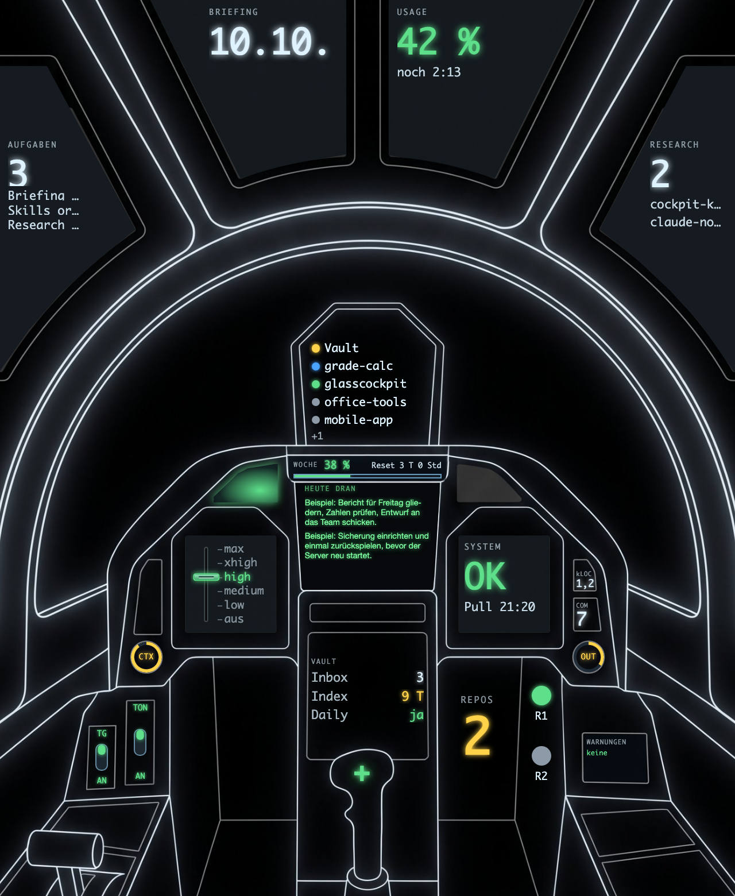

# Glasscockpit

[English](README.md) | Deutsch



Glasscockpit ist ein Obsidian-Plugin. Es startet [Claude-Code](https://code.claude.com)-Sitzungen als Terminal-Tabs im Vault. Ein Dashboard zeigt Limits, Kontextgröße, Aufgaben, Vault-Lage und GitHub-Suchergebnisse, wahlweise als Karten oder als Cockpit-Bild. Das Foto oben zeigt Beispieldaten.

## Voraussetzungen

- macOS auf Apple Silicon. Intel-Macs sind ungetestet.
- Obsidian ab 1.13 (nur Desktop).
- Die Claude-Code-CLI (`claude`), installiert und angemeldet.
- `jq` für die Statuszeile (optional, siehe „Erste Schritte“).

## Installation

**Weg A: ohne ZIP (BRAT, oder der Community-Store, sobald das Plugin dort steht).**

1. Plugin mit BRAT installieren (Repository `nyko073006/glasscockpit`) oder aus der Community-Plugin-Liste. Beide holen nur `main.js`, `manifest.json` und `styles.css`.
2. Glasscockpit unter Einstellungen, Community-Plugins aktivieren.
3. Einstellungen, Glasscockpit, Abschnitt „Binärdateien“, „Binärdateien laden“ drücken. Das Plugin lädt die Terminal-Bibliothek `node-pty` für deinen Mac einmalig herunter und prüft sie (siehe „Netzwerk“ unten). Danach eine Sitzung starten.

**Weg B: das komplette ZIP.**

1. ZIP aus dem GitHub-Release laden: [https://github.com/nyko073006/glasscockpit/releases/latest](https://github.com/nyko073006/glasscockpit/releases/latest)
2. Entpacken. Es entsteht ein Ordner `glasscockpit` mit `main.js`, `manifest.json`, `styles.css` und `native/`.
3. Den Ordner nach `<dein Vault>/.obsidian/plugins/` legen.
4. In Obsidian unter Einstellungen, Community-Plugins, Glasscockpit aktivieren.

Das Plugin steht noch nicht im Community-Store. In `native/` liegt die Terminal-Bibliothek `node-pty` als kompilierte Binärdatei (Weg B bringt sie mit, Weg A lädt sie). Beim ersten Start entfernt das Plugin für diesen Ordner das macOS-Quarantäne-Flag (`xattr`).

## Erste Schritte

In der Befehlspalette „Neue Claude-Sitzung“ oder „Dashboard öffnen“ ausführen. Die Einstellungen stehen unter Einstellungen, Glasscockpit.

Die meisten Vault-Einstellungen sind zu Beginn leer. Leer heißt „nicht eingerichtet“, nie Fehler. Karte oder Feld zeigen dann „aus“ oder „nicht eingerichtet“, und das Plugin liest dafür nichts:

| Einstellung | Leer bedeutet |
|---|---|
| Projektordner | „Neue Sitzung“ bietet keine Projekt-Unterordner an. |
| Briefing-Ordner | Keine Briefing-Karte, kein automatisches `git pull`. |
| Aufgabenliste | Die Karte zeigt „fehlt“ mit einem Knopf zum Anlegen. Vorgabename: `Cockpit Tasks.md`. |
| Inbox-Ordner, Index-Datei, Ordner der Daily Notes | Die Vault-Anzeige steht in dieser Zeile auf „aus“. |
| Lint-Befehl | Kein Lint-Knopf. |
| Radare | Keine Radar-Lampen. Ein Radar ist ein Name plus der Pfad zu einer JSON-Statusdatei, die du selbst schreibst. |

Telegram, die Research-Suchen und die übrigen Schalter haben eigene Vorgaben. Sie stehen unter „Offenlegung“.

### Statuszeile

Claude Code kann eine Statuszeile anzeigen. Dieses Repo bringt eine mit, die zugleich Usage-Karte, Token-Zähler und Kontext-Anzeige speist. Sie braucht `jq`.

```sh
npm run deploy:statusline
```

Das kopiert `statusline/statusline-command.sh` nach `~/.claude/statusline-command.sh`. Eine vorhandene Datei dort wird ersetzt. Danach in `~/.claude/settings.json` auf das Skript zeigen:

```json
{ "statusLine": { "type": "command", "command": "~/.claude/statusline-command.sh", "refreshInterval": 30 } }
```

Ohne Statuszeile läuft das Plugin, aber Usage-Karte sowie Kontext- und Token-Anzeige bleiben leer.

### Übergabe-Signal (optional)

Ein Stop-Hook zeigt nach einer Antwort ein farbiges Banner „Session clearable“, wenn Claude die Session als übergabereif meldet: ein Codeblock, dessen erste Zeile mit `Handoff:` beginnt, oder das Wort „clearable“ ohne „nicht“ davor. Das Banner kommt erst, wenn die Session genug Kontext und genug eigene Nachrichten hat. Beide Schwellen stehen in den Einstellungen („Handoff frühestens ab Kontext (%)“, Vorgabe 10, und „Handoff frühestens ab Nachrichten“, Vorgabe 2). Slash-Befehle zählen nicht als Nachricht. Den Kontext liest der Hook aus der Statuszeile; ohne sie gilt nur die Nachrichten-Schwelle. Er braucht `python3`.

```sh
npm run deploy:hook
```

Das kopiert `hooks/clearable-banner.py` nach `~/.claude/hooks/clearable-banner.py`. Danach in `~/.claude/settings.json` eintragen:

```json
{ "hooks": { "Stop": [ { "hooks": [ { "type": "command", "command": "python3 \"$HOME/.claude/hooks/clearable-banner.py\" 2>/dev/null || true", "timeout": 10 } ] } ] } }
```

Damit Claude das Signal setzt, braucht es eine Anweisung in deiner `CLAUDE.md`, etwa: „Ist die Session übergabereif, endet die Antwort mit einem Codeblock, der mit `Handoff:` beginnt.“

## Handoffs

Das Plugin kann ein Projekt aus der Handoff-Notiz einer früheren Sitzung fortsetzen. Es ist aus, bis zwei Pfade gesetzt sind.

| Einstellung | Bedeutung |
|---|---|
| `hubsDir` | Vault-Ordner mit je einem Unterordner pro Projekt. Leer = aus. |
| `handoffsDir` | Ordnername in jedem Projektordner, der die Handoff-Notizen enthält. Leer = aus. |
| `hubSuffix` | Endung der Hub-Notiz des Projekts. Vorgabe `" - PMO HUB.md"`. |
| `handoffPrompt` | Erste Nachricht der fortgesetzten Sitzung. `{datei}` wird der Handoff-Pfad, `{auftrag}` der nächste Auftrag. |

Ein Handoff ist eine Markdown-Notiz mit diesem Frontmatter:

```yaml
status: offen            # offen = wartet, aufgenommen = übernommen
erstellt: 2026-01-05
naechster_auftrag: Kurzbeschreibung des nächsten Auftrags
```

Die Hub-Notiz kann den Repo-Ordner des Projekts mit `repo: ~/pfad/zum/repo` nennen. `~` ist dein Home-Ordner. Ohne `repo` oder bei fehlendem Ordner startet die Sitzung im Vault, und der Eintrag sagt das.

Pro Projekt zählt der neueste offene Handoff. Das Feld „Neue Sitzung“ im Dashboard zeigt „N offen“. Das Menü für neue Sitzungen führt jeden als „Weiter“ vor den normalen Einträgen, und Enter ohne Eingabe nimmt den obersten Eintrag. Das Plugin setzt `status: aufgenommen` (und `aufgenommen: <Datum>`) erst, wenn die Sitzung läuft; ein gescheiterter Start lässt den Handoff offen.

## Mindestkontrast im Terminal

Claude Code schickt manchen Text (etwa die Frage einer Auswahlmaske) fest in Weiß. In einem hellen Obsidian-Theme ist er dann unsichtbar. Die Einstellung „Mindestkontrast im Terminal“ (1 bis 21, Vorgabe 4,5, 1 = aus) hebt Text, der für den Hintergrund zu blass ist, auf dieses Kontrastverhältnis an. Sie wirkt sofort auf offene Terminals.

## Pfade per Cmd+Klick öffnen

Dateipfade im Terminal öffnen sich per Cmd+Klick: absolut, mit `~` oder relativ zum Startordner der Sitzung, jeweils auch mit `:zeile` oder `:zeile:spalte`. Mit gedrückter Cmd-Taste ist ein Pfad unterstrichen, aber nur, wenn er als Datei existiert. Dateien im Vault öffnen als Tab, alle anderen in einem Fenster mit Rohtext-Editor: Cmd+S speichert, Esc schließt. Hat sich die Datei seit dem Öffnen geändert (etwa durch Claude), fragt das Fenster vor dem Überschreiben. Größere Dateien als die „Datei-Viewer: Höchstgröße (MB)“ (Vorgabe 2) und Binärdateien zeigt es nicht. Ausschalten mit „Pfade per Cmd+Klick öffnen“. In Shell-Sitzungen gilt nach `cd` weiter der Startordner.

Liegt ein relativer Pfad nicht im Startordner, sucht das Cockpit ihn in den Ordnern, in denen Claude in dieser Sitzung gearbeitet hat: Ziele von `cd`, Ordner gelesener und bearbeiteter Dateien. Nennt Claude in einer Vault-Sitzung `src/main.ts:10` aus einem Repo, wird das so ein Link. Gibt es die Datei in mehreren dieser Ordner, etwa im Repo und in einem Worktree, öffnet sie aus dem Ordner, in dem Claude zuletzt gearbeitet hat; der Fenstertitel zeigt den vollen Pfad. Ausschalten mit „Relative Pfade auch in Claudes Ordnern suchen“.

## Banner ausblenden

Das macOS-Banner (Einstellung „macOS-Banner“) schließt sich nach der Zeit „Banner ausblenden nach (Sekunden)“ von selbst (1 bis 60, Vorgabe 6) und steht danach nicht in der Mitteilungszentrale. Je Sitzung gibt es höchstens ein Banner: Ein neues ersetzt das alte. Beim Ausschalten des Plugins werden offene Banner geschlossen. Ein Klick holt die Sitzung nach vorn. Ist `@electron/remote` in Obsidian nicht verfügbar, zeigt das Plugin das Banner über das Fenster; dann gibt es keine Garantie, dass es sich schließt.

## Rechteabfragen überspringen

Der Schalter „Rechteabfragen überspringen“ ist in der Vorgabe aus.

**Warnung:** Ist er an, starten neue Sitzungen mit `--dangerously-skip-permissions`. Claude führt dann Befehle aus und ändert Dateien, ohne zu fragen. Schalte ihn nur in Ordnern und Vaults an, in denen du das hinnimmst.

Der Schalter wirkt nur auf Sitzungen, die danach starten. Laufende Sitzungen behalten ihren Modus.

## Offenlegung

Das folgt den Offenlegungsregeln der Obsidian-Entwicklerrichtlinien.

**Führt Programme aus.**
- `claude` in einer Terminal-Sitzung, bei Shell-Sitzungen deine `$SHELL`. Beim Laden startet das Plugin einmal deine Login-Shell (`$SHELL -i -l -c`), um `PATH` und `LANG` zu lesen.
- `git pull --ff-only` im Briefing-Ordner, nur wenn du einen einträgst (Vorgabe alle 5 Minuten, solange ein Dashboard offen ist).
- `git status` in deinen Projektordnern für die Repo-Anzeige. Kein Fetch.
- `afplay` für den Alarmton, `xattr` für das Quarantäne-Flag, `ps` für den Elternprozess der IDE-Brücke.

**Liest außerhalb des Vaults.**
- `~/.claude/projects/`: die Claude-Transkripte, um Tokens zu zählen, den letzten Codeblock zu finden, die aktive Sitzung zu zeigen und die Ordner zu kennen, in denen Claude gearbeitet hat (für relative Pfade).
- `~/.claude/skills/`, `agents/`, `commands/`, `settings.json` und `plugins/installed_plugins.json`: für die Listen im Launcher. Dieselben Ordner im Vault und im Projektordner werden ebenfalls gelesen.
- `~/.claude/cockpit/`: `usage.json` und `sessions/*.json` (schreibt das Statuszeilen-Skript) sowie die eigenen Dateien unten.
- Nur bei aktivem Telegram: die `.env`-Datei aus den Einstellungen (Vorgabe `~/.claude/channels/telegram/.env`) für das Bot-Token und `access.json` daneben für die Chat-ID. Das Token wird bei jeder Nachricht neu gelesen und vom Plugin nie gespeichert.
- Radar-Statusdateien unter den Pfaden, die du einträgst.
- Pfade, die im Terminal stehen: beim Überfahren mit der Maus nur ein `stat` auf die Pfade dieser Zeile, der Inhalt erst nach Cmd+Klick (Schalter „Pfade per Cmd+Klick öffnen“).

**Schreibt außerhalb des Vaults.**
- `~/.claude/cockpit/tokens-today.json` (heutige Output-Tokens für die Statuszeile; Schalter „Tokens für die Statuszeile schreiben“, Vorgabe an), `thresholds.json` (Kontext-Schwellen aus deinen Einstellungen) und `research.json` (Zwischenspeicher der GitHub-Ergebnisse).
- Die Datei, die du im Datei-Viewer mit Cmd+S speicherst, und nur diese (Schalter „Pfade per Cmd+Klick öffnen“, Vorgabe an). Gespeichert wird über eine Temp-Datei im selben Ordner, die umbenannt wird.
- `~/.claude/ide/<port>.lock`: Lockfile der IDE-Brücke (Schalter „IDE-Brücke“, Vorgabe an). Damit sehen vom Plugin gestartete Claude-Sitzungen deine Auswahl und können Notizen öffnen. Der Server hört nur auf `127.0.0.1`. Das Lockfile verschwindet beim Beenden.
- `npm run deploy:statusline` schreibt `~/.claude/statusline-command.sh`. Das startest du selbst.
- `npm run deploy:hook` schreibt `~/.claude/hooks/clearable-banner.py`, das startest du ebenfalls selbst. Der Hook liest `~/.claude/cockpit/thresholds.json`, `sessions/*.json` und das Transkript der Sitzung und schreibt ein Protokoll nach `~/.claude/hooks/clearable-banner.log`.

**Schreibt im Vault.** Die `data.json` des Plugins (Einstellungen, Sitzungsliste), den Ordner `native/darwin-<arch>/` im Plugin-Ordner bei „Binärdateien laden“ (dazu währenddessen einen Hilfsordner `.native-download-*`, danach entfernt), die Aufgabendatei bei „Anlegen“ oder beim Abhaken einer Aufgabe und das Ergebnis von `git pull` im Briefing-Ordner.

**Netzwerk.**
- GitHub-Suche (`api.github.com/search/repositories`) für die Research-Karte, ohne Token. Gesendet werden nur die Suchzeilen aus den Einstellungen. Ohne Token erlaubt GitHub 10 Suchen pro Minute.
- Telegram (`api.telegram.org`), nur wenn du „Telegram, wenn eine Sitzung fertig ist“ oder „… eine Frage hat“ einschaltest (beide in der Vorgabe aus). Gesendet wird ein kurzer Statustext.
- Binär-Download, nur wenn du in den Einstellungen „Binärdateien laden“ drückst, nie von selbst: ein ZIP (rund 40 KB) mit dem kompilierten `node-pty` für deinen Mac von `github.com/nyko073006/glasscockpit/releases/download/<Plugin-Version>/glasscockpit-native-darwin-<arch>.zip`. Das Plugin sendet dabei nichts außer der Anfrage selbst. Die Adresse steht fest im Code. Bevor etwas installiert wird, wird jede Datei des Downloads mit einer SHA256-Liste verglichen, die im Plugin eingebaut ist (keine Zusatzdateien, keine Symlinks, jede Summe muss stimmen); bei jeder Abweichung bleibt alles unverändert. Die geladenen Dateien sind nativer Code, den Obsidian danach lädt; die Summen sind deshalb die Absicherung: Sie stammen aus dem Plugin selbst, nicht aus dem Download.
- Claude Code selbst spricht mit Anthropic. Das ist das Programm `claude`, nicht dieses Plugin.

**Keine Telemetrie.** Das Plugin sendet keine Nutzungsdaten, keine Analytics und keine Absturzberichte.

**Keine Verbindung.** Glasscockpit hat keine Verbindung zu Anthropic oder Obsidian und wird von keinem von beiden unterstützt. „Claude“ und „Obsidian“ sind Marken der jeweiligen Inhaber.

## Grenzen

- Nur macOS. In `native/` liegen Binärdateien für Apple Silicon (arm64) und Intel (x64); der Loader wählt nach Architektur. Getestet ist arm64, x64 ist in Obsidian ungetestet.
- Die Oberfläche ist deutsch.
- Teile der IDE-Brücke nutzen ein inoffizielles Protokoll von Claude Code und können bei einem Update brechen. Fehler gehen nur in die Entwicklerkonsole.
- Manches lässt sich nur in Obsidian prüfen. Die Tests decken die Logik ab, nicht das ganze Plugin.

## Lizenz

MIT, siehe [LICENSE](LICENSE). Drittlizenzen stehen in [THIRD-PARTY-NOTICES.md](THIRD-PARTY-NOTICES.md).

Das Hintergrundbild `assets/cockpit-bg.jpg` wurde mit Google Flow (Nano Banana Pro) KI-generiert.
